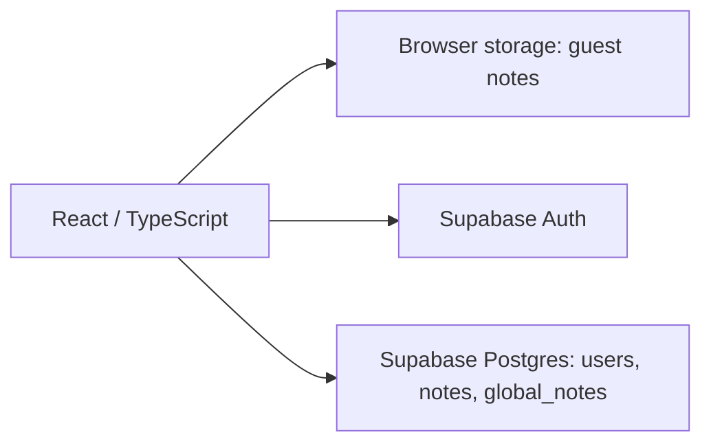

# Jot Notes

A React and TypeScript note-taking app with browser-local notes, private account notes, and a separate public Global Notes feed. Start writing without an account, then sign in when you want notes stored against your account.

[Open Jot Notes](https://jot-notes.app/)

## What it does

| Mode | Storage and behavior |
| --- | --- |
| Guest notes | Create and delete notes without signing in. Notes persist in `localStorage` by default. Turning off persistence uses `sessionStorage`, which survives refreshes within the tab session. |
| Account notes | Sign up or sign in with Supabase Auth. The app reads and writes notes directly through Supabase, and Row Level Security limits each account to its own notes. |
| Global Notes | Anyone can read the public feed. Signed-in users can publish a note to a separate `global_notes` table. The feed shows the latest 100 entries. |

The interface also includes light/dark themes, input length limits, loading and service-unavailable states, and a web app manifest with a service worker for installation support.

Guest and account notes are separate collections; signing in does not automatically upload the notes saved on your device. Global Notes are public and should contain only information intended for public viewing.

## Architecture

The app is a static site with no server of its own. It talks to Supabase with the publishable key, and the database enforces access: Row Level Security scopes notes to their owner, a trigger creates a profile when someone signs up, and column defaults attach new notes to the signed-in user. The Global Notes feed is readable without signing in.

## Stack

- **Frontend:** React, TypeScript, Vite, Tailwind CSS, DaisyUI.
- **Identity and data:** Supabase Auth and Postgres (Row Level Security).
- **Hosting:** Cloudflare Pages (static).
- **Browser features:** local/session storage, theme preferences, web app manifest, and service worker.

## Repository map

| Path | Purpose |
| --- | --- |
| `src/components/` | Note composer, note cards, navigation, account UI, and storage state |
| `src/lib/` | Supabase client and query error handling |
| `config/supabase-config.ts` | Shared public Supabase connection and key validation |
| `supabase/migrations/` | Database changes for direct frontend access |

## Running locally

Use Node 24 (the exact version is in `.node-version`), then run `npm ci` and `npm run dev`. The frontend and build share the public Supabase URL and publishable key in `config/supabase-config.ts`; no environment-file setup is needed.

Run `npm run check` for lint, frontend security tests, isolated PostgreSQL migration tests, and a production build.

## Deploying to Cloudflare Pages

- Build command: `npm run build`
- Build output directory: `dist`
- Supabase connection: `config/supabase-config.ts`. No Supabase environment variables are required in Pages. Changing projects requires updating the shared config and rebuilding.

See [the migration guide](docs/cloudflare-pages.md) for database bootstrap/migrations, the approved quotas, Auth settings, preview isolation, and the cutover checklist. Applying SQL or changing hosted account settings is a separate step from building the static frontend.

## Current scope

The implemented note workflow supports creation, viewing, and deletion. Editing existing notes, import/export, Markdown rendering, share-by-link collaboration, and automatic one-hour expiration of Global Notes are not implemented in the current source.
