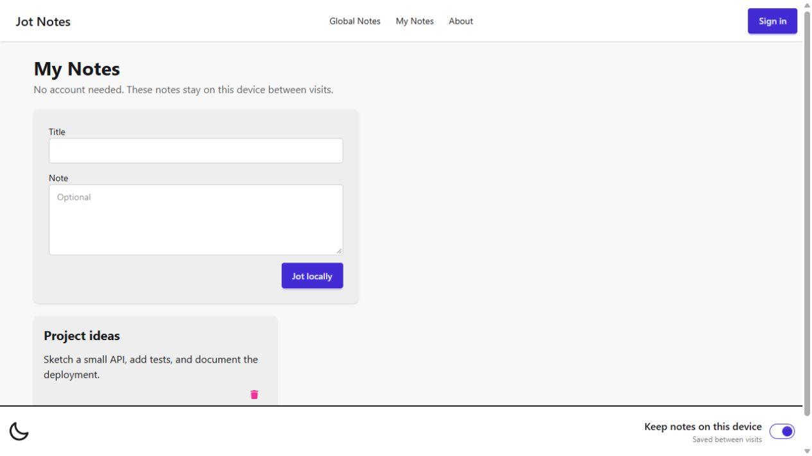
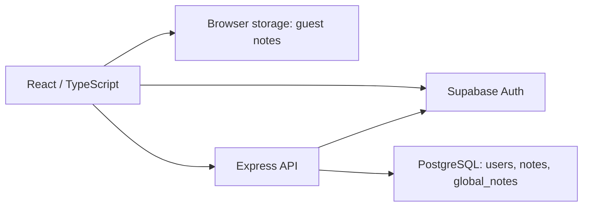

# Jot Notes

A React and TypeScript note-taking app with browser-local notes, private account notes, and a separate public Global Notes feed. Start writing without an account, then sign in when you want notes stored against your account.

[Open Jot Notes](https://jot-notes.app/)

## What it does

| Mode | Storage and behavior |
| --- | --- |
| Guest notes | Create and delete notes without signing in. Notes persist in `localStorage` by default. Turning off persistence uses `sessionStorage`, which survives refreshes within the tab session. |
| Account notes | Sign up or sign in with Supabase Auth. The Express API verifies the access token and stores private notes in PostgreSQL against the authenticated user. |
| Global Notes | Anyone can read the public feed. Signed-in users can publish a note to a separate `global_notes` table. The API returns the latest 100 entries. |

The interface also includes light/dark themes, input length limits, loading and service-unavailable states, and a web app manifest with a service worker for installation support.

Guest and account notes are separate collections; signing in does not automatically upload the notes saved on your device. Global Notes are public and should contain only information intended for public viewing.

## Architecture

The frontend sends a bearer token for account operations. The API verifies it with Supabase Auth, resolves the corresponding application profile, and scopes private-note queries to that user. Public feed reads use a separate endpoint. The repository also includes the incremental SQL migrations used to introduce the Supabase user mapping and database access policies.

## Stack

- **Frontend:** React, TypeScript, Vite, Tailwind CSS, DaisyUI.
- **Backend:** Node.js, Express, TypeScript, and `pg`.
- **Identity and data:** Supabase Auth and PostgreSQL.
- **Browser features:** local/session storage, theme preferences, web app manifest, and service worker.

## Repository map

| Path | Purpose |
| --- | --- |
| `frontend/src/components/` | Note composer, note cards, navigation, account UI, and storage state |
| `frontend/src/lib/` | Supabase client and authenticated API requests |
| `backend/src/` | Express routes, token verification, profile provisioning, and parameterized SQL |
| `supabase/migrations/` | Incremental auth and database-policy migrations |

## Current scope

The implemented note workflow supports creation, viewing, and deletion. Editing existing notes, import/export, Markdown rendering, share-by-link collaboration, and automatic one-hour expiration of Global Notes are not implemented in the current source.
